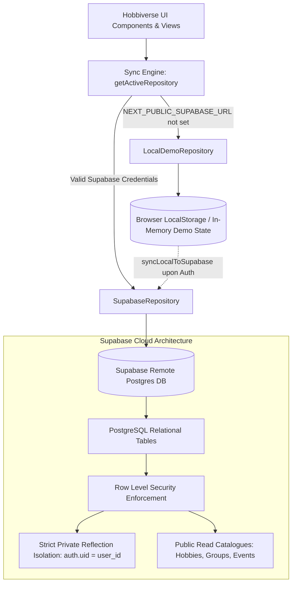

# Hobbiverse Supabase Architecture & Setup Guide

This guide details the complete database configuration, relational schema migrations, Row Level Security (RLS) policies, and hybrid sync engine architecture for **Hobbiverse**.

---

## 1. Architecture Overview

Hobbiverse is designed with an **offline-first, privacy-respecting hybrid architecture**. The application functions completely out of the box in a zero-configuration local sandbox (`LocalDemoRepository`), and seamlessly upgrades to a persistent cloud database (`SupabaseRepository`) as soon as Supabase credentials are provided.



---

## 2. Environment Variables

Create a `.env.local` file in the root directory (based on `.env.example`):

```bash
# Public Client Keys (Safe to expose to browser bundle)
NEXT_PUBLIC_SUPABASE_URL=https://your-project-id.supabase.co
NEXT_PUBLIC_SUPABASE_ANON_KEY=eyJhbGciOiJIUzI1NiIsInR5cCI6IkpXVCJ9...

# Optional Server-Only Key (NEVER expose to client bundles)
SUPABASE_SERVICE_ROLE_KEY=your-server-service-role-key-here
```

### Security Boundary:
- `NEXT_PUBLIC_SUPABASE_ANON_KEY` is subject to all Row Level Security (RLS) rules and can only access rows permitted by RLS policies.
- `SUPABASE_SERVICE_ROLE_KEY` bypasses RLS and must strictly remain on the server side (`src/lib/supabase/server.ts`) for administrative maintenance.

---

## 3. Migration Inventory

All schema migrations are located in [`supabase/migrations/`](file:///c:/Users/SHOURYA/HOBBIVERSE/supabase/migrations/):

| Migration File | Description |
| :--- | :--- |
| [`20261019000000_create_hobbiverse_schema.sql`](file:///c:/Users/SHOURYA/HOBBIVERSE/supabase/migrations/20261019000000_create_hobbiverse_schema.sql) | Creates all 22 domain tables, foreign keys, cascade deletes, constraints, and performance indexes. |
| [`20261019000001_row_level_security.sql`](file:///c:/Users/SHOURYA/HOBBIVERSE/supabase/migrations/20261019000001_row_level_security.sql) | Enables RLS across 100% of tables with strict user ownership and isolated private journal reflections. |
| [`20261019000002_seed_data.sql`](file:///c:/Users/SHOURYA/HOBBIVERSE/supabase/migrations/20261019000002_seed_data.sql) | Seeds 8 core categories, 8 rich beginner hobbies with structured steps, kindred circles, events, and challenges. |

---

## 4. Applying Migrations

### Method A: Via Supabase CLI (Recommended for Development)

1. **Install Supabase CLI:**
   ```bash
   npm install -g supabase
   ```
2. **Authenticate CLI:**
   ```bash
   supabase login
   ```
3. **Link to your Remote Project:**
   ```bash
   supabase link --project-ref your-project-id
   ```
4. **Push Schema Migrations:**
   ```bash
   supabase db push
   ```

### Method B: Via Supabase Studio (Web Dashboard)

1. Open your project on [supabase.com/dashboard](https://supabase.com/dashboard).
2. Navigate to the **SQL Editor** tab on the left sidebar.
3. Open and run the migration files in numerical order:
   - Run `20261019000000_create_hobbiverse_schema.sql`
   - Run `20261019000001_row_level_security.sql`
   - Run `20261019000002_seed_data.sql`
4. Verify all tables in the **Table Editor**.

---

## 5. Row Level Security & Ethical Privacy Model

Hobbiverse enforces non-diagnostic wellness boundaries and strict data confidentiality.

### Table Access Matrix

| Table | Public Read | Authenticated Read | User Write / Mutation | RLS Policy |
| :--- | :---: | :---: | :---: | :--- |
| `categories` | Yes | Yes | Admin Only | Public read |
| `hobbies` & `hobby_steps` | Yes | Yes | Admin Only | Public read |
| `groups` & `events` | Yes | Yes | Admin Only | Public read |
| `challenges` | Yes | Yes | Admin Only | Public read |
| `community_posts` | Yes | Yes | Author Only (`auth.uid() = author_id`) | Authors manage own posts |
| `comments` | Yes | Yes | Author Only (`auth.uid() = author_id`) | Authors manage own comments |
| `profiles` | If `is_public` | Yes | Self Only (`auth.uid() = id`) | User-controlled profile visibility |
| `saved_hobbies` | No | Self Only | Self Only (`auth.uid() = user_id`) | Personal Bookshelf |
| `activity_sessions` | No | Self Only | Self Only (`auth.uid() = user_id`) | Personal Activity History |
| `planned_activities` | No | Self Only | Self Only (`auth.uid() = user_id`) | Personal Intentional Calendar |
| `journal_entries` | **NEVER** | **Self Only** | **Self Only (`auth.uid() = user_id`)** | **Strict Reflection Isolation** |

### Private Reflection Isolation Guarantee:
```sql
CREATE POLICY "Users have exclusive access to their own private reflections"
  ON public.journal_entries FOR ALL
  USING (auth.uid() = user_id)
  WITH CHECK (auth.uid() = user_id);
```
No user, peer, group, or moderator can view another user's journal entries. Reflections are completely confidential.

---

## 6. Hybrid Sync Engine (`syncEngine.ts`)

The sync engine bridges offline exploration with remote cloud synchronization:

1. **Automatic Runtime Detection:**
   [`getActiveRepository()`](file:///c:/Users/SHOURYA/HOBBIVERSE/src/services/syncEngine.ts) inspects [`isSupabaseConfigured()`](file:///c:/Users/SHOURYA/HOBBIVERSE/src/lib/supabase/client.ts). If environment variables are absent, it returns `LocalDemoRepository`.
2. **First-Time Account Migration (`syncLocalToSupabase`):**
   When an anonymous demo user signs up or signs in, their local sandbox state (saved hobbies, logged sessions, routines, and private reflections) can be synced to their newly authenticated Supabase account without data loss.

---

## 7. Verification

Run the test suite to verify that both demo repository fallbacks and build pipelines remain pristine:

```bash
# Verify 7 core user journeys (33 assertions)
npm run verify:journeys

# TypeScript compiler check
npx tsc --noEmit

# Production build check
npm run build
```
